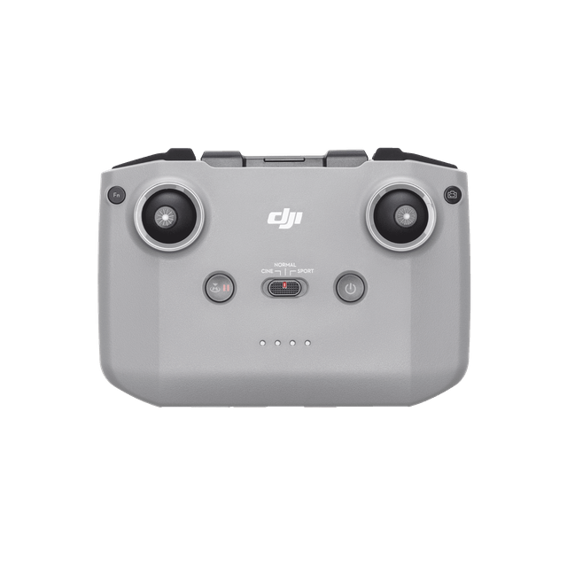
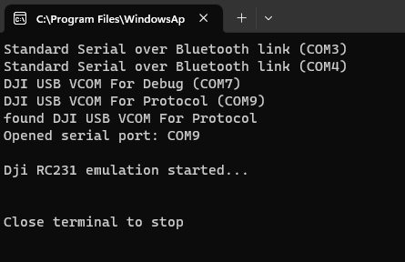
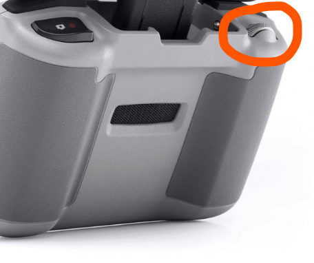
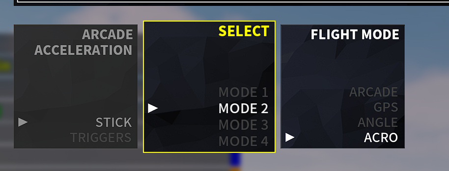
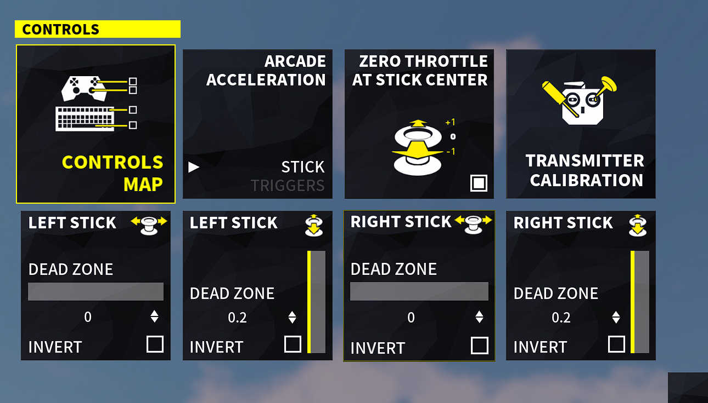
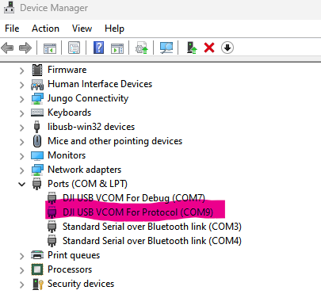

# DJI RC-Nx Simulator Gamepad

[](https://github.com/Chris0571/DJI-RC-Nx-Simulator-Gamepad)
[](https://www.python.org/)
[](LICENSE)
[](https://t.me/krys_cern)
[](https://buymeacoffee.com/chris0571)

Connect your **DJI RC-N1 / RC-N2 / RC-N3 (RC231)** remote controller to your **Windows PC** via USB and use it as a virtual Xbox 360 controller in FPV and drone flight simulators (such as *DCL - The Game*, *Liftoff*, *Uncrashed*, *Tryp FPV*, etc.).

<p align="center">
  
</p>

---

## Table of Contents

- [Features](#features)
- [Compatibility](#compatibility)
- [Installation & Requirements](#installation--requirements)
- [Usage](#usage)
- [Controls & Mapping](#controls--mapping)
- [Troubleshooting](#troubleshooting)
- [Donate](#donate)
- [License](#license)

---

## Features

- **Xbox 360 Gamepad Emulation**: Uses `vgamepad` (ViGEm) for native controller support in Windows games and simulators.
- **Automatic Port Detection**: Automatically searches for the `DJI USB VCOM For Protocol` serial interface.
- **Fast Stick Response**: Automatically enables simulator mode via DJI DUML protocol commands for full refresh rate.
- **Auxiliary Controls**: Maps the camera gimbal wheel to in-game actions (e.g. quick race restart or drone recovery).

---

## Compatibility

- **Supported Controllers**:
  - DJI RC-N1 (Model RC231 / Mavic 3 / Air 2S / Mini 2 / Mini 3)
  - DJI RC-N2 (Air 3 / Mini 4 Pro)
  - DJI RC-N3 (Neo / Air 3S)
- **Tested Simulators**:
  - [DJI Fly Simulator](https://service-adhoc.dji.com/download/app/pc/3cf0bf93-8700-4b6d-af16-dbdabe3abd4f)
  - [DCL - The Game](https://store.steampowered.com/app/964570/DCL__The_Game/)
  - Liftoff, Uncrashed, Velocidrone, and any simulator accepting standard Xbox controller inputs.

  

---

## Installation & Requirements

### 1. Install DJI Drivers
Download and install [DJI Assistant 2 (Consumer Drones Series)](https://www.dji.com/downloads/softwares/dji-assistant-2-consumer-drones-series).  
This installs the required **DJI USB VCOM** drivers.  
> **Important:** Close DJI Assistant 2 after installation so it does not block the serial COM port.

### 2. Python Dependencies
Ensure Python 3.9+ is installed, then install the required libraries:
```bash
pip install vgamepad pyserial
```

---

## Usage

1. **Power on** your DJI Remote Controller *(single press, then long press)*.
2. **Connect** the controller to your PC using a **data-capable USB-C cable** (ensure it supports data transfer, not charge-only) plugged into the **bottom USB-C port** (not the phone clamp port).
3. **Start the program**:
   ```bash
   python main.py
   ```
   *(or double-click `start.bat` on Windows)*.
4. When connected, the terminal will confirm the connection:
   <p align="center">
     
   </p>
5. Launch your simulator and set up your controls.

> [!TIP]
> **Quick Test on Windows (`joy.cpl`):**  
> You can verify your controller is working before opening your simulator: press <kbd>Win</kbd> + <kbd>R</kbd>, type `joy.cpl`, and hit **Enter**. Select the virtual **Xbox 360 Controller for Windows** and click **Properties** to see real-time stick inputs and button responses!

---

## Controls & Mapping

| DJI Controller Input | Virtual Xbox 360 Mapping | Typical Function |
| :--- | :--- | :--- |
| **Left Stick** | Left Joystick (X / Y) | Throttle / Yaw (Mode 2) |
| **Right Stick** | Right Joystick (X / Y) | Pitch / Roll (Mode 2) |
| **Gimbal Wheel (Up)** | Button `Y` | Restart Race / Respawn |
| **Gimbal Wheel (Down)** | Button `B` | Recover Drone |

<p align="center">
  
</p>

### Recommended Simulator Preset
For FPV simulators (e.g. *DCL - The Game*):
- **Preset**: Mode 2
- **Flight Mode**: Acro
- **Throttle**: Zero throttle at stick center

<p align="center">
  
  
</p>

---

## Troubleshooting

- **Controller Not Detected**:
  - Ensure you are using a **USB-C data cable** (some phone charging cables only supply power and cannot transfer data).
  - Make sure the cable is plugged into the **bottom USB-C port**.
  - Check Windows Device Manager: under **Ports (COM & LPT)** you should see `DJI USB VCOM For Protocol`.
    <p align="center">
      
    </p>
  - Ensure DJI Assistant 2 is completely closed and not occupying the COM port.
- **Manual Port Selection**:
  - If auto-detection fails, specify the port manually with:
    ```bash
    python main.py -p COM9
    ```

---

## Donate

If you find this project useful, you can support the development:

### Buy Me a Coffee

<p align="center">
  <a href="https://buymeacoffee.com/chris0571" target="_blank">
    
  </a><br/>
  <a href="https://buymeacoffee.com/chris0571" target="_blank"><b>buymeacoffee.com/chris0571</b></a>
</p>

### Bitcoin

<p align="center">
  <br/>
  <code>bc1qh40vyg6m4aakxlmxmd9qn5hqq5wq85sg7pw2rz</code>
</p>

---

## License

This project is licensed under the GNU General Public License v3.0 - see the [LICENSE](LICENSE) file for details.
